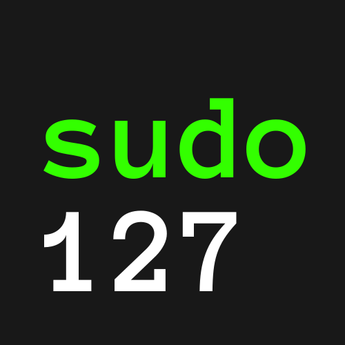

  

<h3 align="center">Custom software, built beside your team.</h3>

  Enterprise systems designed, built and run in Cyberjaya, Malaysia. 
  Our engineers work on site with you, so the system fits how you actually work.

  <a href="https://sudo127.com">sudo127.com</a> ·
  <a href="https://sudo127.com/work">Work</a> ·
  <a href="https://sudo127.com/events">Event technology</a> ·
  <a href="https://sudo127.com/contact">Talk to us</a>

---

### Our own products

| Product | What it does | Status |
|---|---|---|
| **[pay127](https://pay127.com)** | Accounting with an AI assistant. Quotations, invoices, bills and expenses for Malaysian businesses. | Live |
| **[work127](https://sudo127.com/products/work127)** | Projects, crews, equipment and HR in one workspace, with apps for the team on site. | Early access |
| **[PostoBox](https://postobox.app)** | Live Q&A for events. Attendees ask and vote from their phones, no app needed. | Live |

We run sudo127 on the software we build.

### Event technology

Technology partner to [EzyEvents](https://ezyevents.my). We build **EzyOS** (registration, tickets, check-in and reports, with an open API) and **EzyKiosk** (badge printing at the door, even when the Wi-Fi drops).

| Event | What happened |
|---|---|
| [Youth Economic Forum 2026](https://sudo127.com/work/yef-2026) | 2,684 attendees reached in one reminder run |
| [NICE 2026 for MRANTI](https://sudo127.com/work/nice-2026) | 200+ 1:1 meetings between 76 companies and 18 funds |
| [Connectd 9.0](https://sudo127.com/work/connectd) | 394 attended, 2,724 connections made |
| [MSH Congress 2026](https://sudo127.com/work/msh-congress) | 172 live audience questions, each matched to its session |

### Platforms we build and run

Abedeen Academy · CIC · Gantify · TERAJU ASCEND · Islamic Medical Association of Malaysia · Malaysian Society of Hypertension · Faith Events · IIUM Kulliyyah of Pharmacy · Parcel Malaya

Web, iOS and Android, connected to WhatsApp, kiosks, accounting and payment gateways (CHIP, Stripe, HitPay).

### Why "sudo127"

`sudo` gets things done. `127.0.0.1` is home. We build close to home, and close to our clients.

---

SUDO127 TECHNOLOGY SDN. BHD. (202501016168) · Cyberjaya, Selangor · <a href="mailto:hello@sudo127.com">hello@sudo127.com</a>
